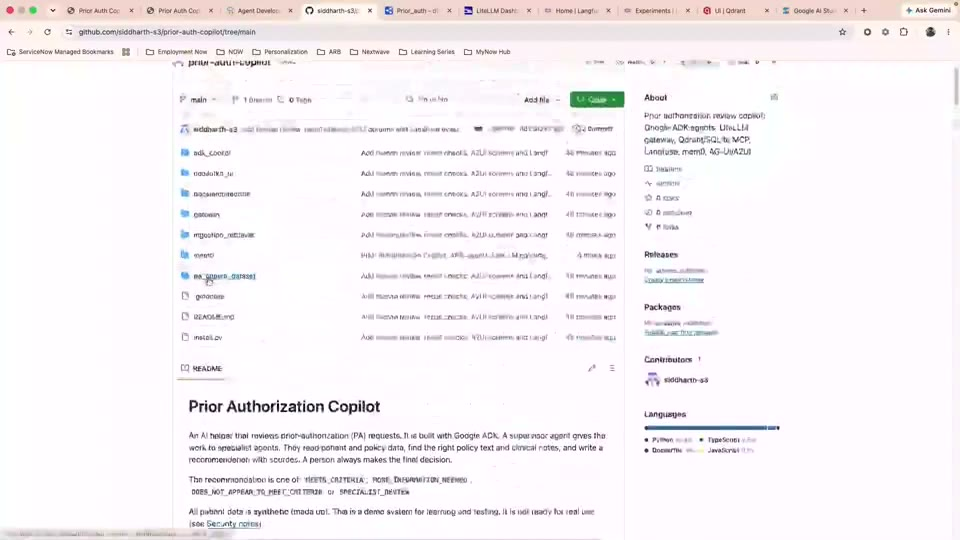
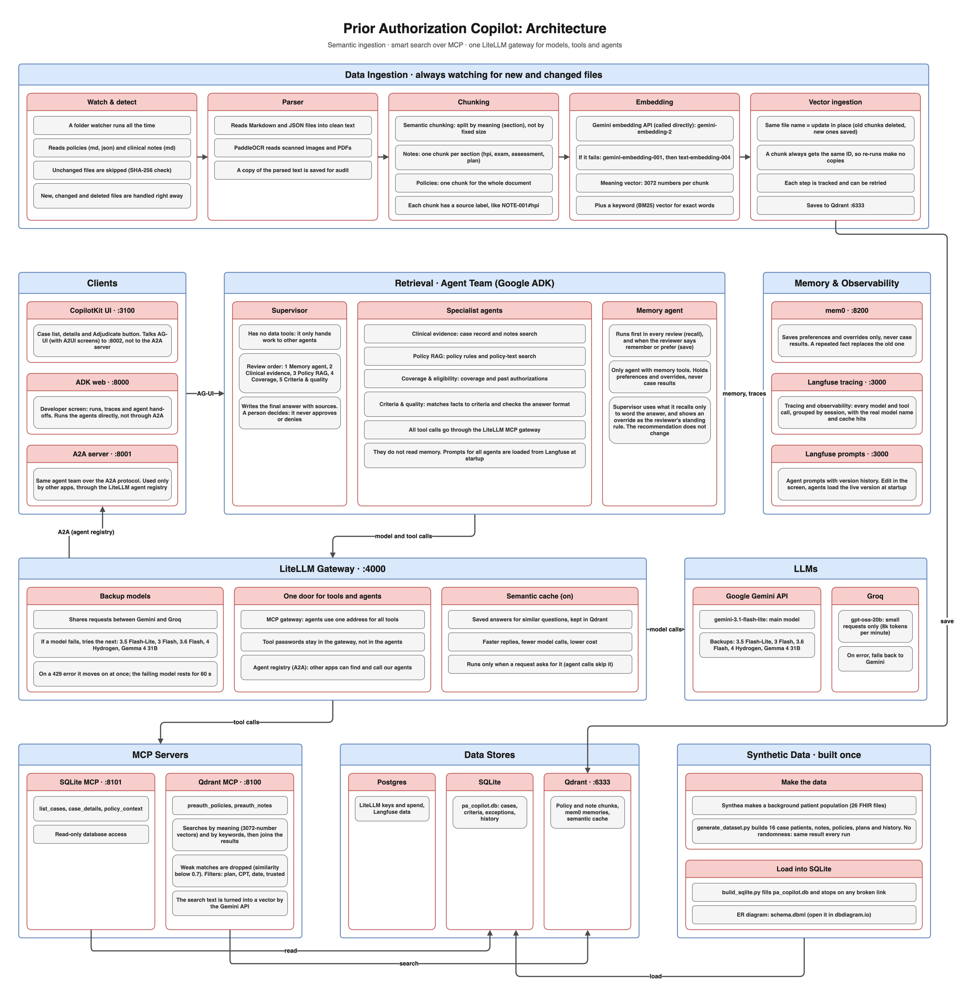

# Prior Authorization Copilot

An AI helper that reviews prior-authorization (PA) requests. It is built with Google ADK. A supervisor
agent gives the work to specialist agents. They read patient and policy data, find the right policy text
and clinical notes, and write a recommendation with sources. A person always makes the final decision.

The recommendation is one of: `MEETS_CRITERIA`, `MORE_INFORMATION_NEEDED`,
`DOES_NOT_APPEAR_TO_MEET_CRITERIA` or `SPECIALIST_REVIEW`.

All patient data is **synthetic** (made up). This is a demo system for learning and testing. It is not ready for
real use (see [Security notes](#security-notes)).

## Demo video

[](https://github.com/siddharth-s3/prior-auth-copilot/raw/main/docs/demo-video.mp4)

Click the thumbnail to watch the 24-minute demo. (It opens the video stream in a new browser tab —
GitHub does not inline-play repo files; your browser plays the MP4 directly. If a GitHub notice page
appears instead, the companion link under *docs/demo-video.mp4* on the file page works too.)

## Highlights

- **Always-on ingestion**
  - A folder watcher notices new, changed and deleted files right away
  - Files that did not change are skipped
  - A file with the same name is updated in place, so there are no copies
- **Semantic chunking.** Text is split by meaning (by section), not by a fixed size.
- **Hybrid search**
  - Finds text by meaning, using 3072 numbers (a vector) for each piece of text
  - Also finds exact words (keywords)
  - Joins both results into one ranked list
  - Drops weak matches (similarity below 0.7)
  - Can filter by plan, procedure code (CPT), date and trusted status
- **Policy version aware**
  - Uses the policy version that was valid on the request date
  - A policy for one plan wins over the general policy
  - Checks red-flag rules, exclusions and exception dates
- **LiteLLM gateway** (one place for models, tools and agents)
  - Shares requests between Gemini and Groq
  - Has backup models: if one fails, it tries the next of 5 Gemini models (Flash-Lite, Flash, 3.6 Flash, 4 Hydrogen, Gemma 4)
  - Switches fast: on an error like 429 ("too many requests") error it moves to the next model at once, and the failing model rests for 60 seconds
  - **MCP gateway**: agents use one address for all tools, so they do not need to know each tool server masking the server address for security
  - **MCP gateway**: tool passwords stay in the gateway, not in the agents, and a tool server can be changed in one place
  - **Agent registry (A2A)**: our agent team is listed in one place
  - **Agent registry (A2A)**: other apps and agents can find it and call it with the standard A2A protocol, with no custom code
  - **Semantic cache is on** (kept in Qdrant)
  - The cache gives a saved answer to a similar question: faster replies, fewer model calls, lower cost and less quota used
  - The cache runs only when a request asks for it. Agent calls skip it, because their long prompts look alike and could get a wrong saved answer
- **Observability (Langfuse)**
  - **Tracing**: every agent step, model call and tool call is recorded
  - **Tracing**: calls are grouped by session, so you can follow one conversation
  - **Prompt versions**: agent prompts are saved in Langfuse with a version history
  - **Prompt versions**: edit a prompt in Langfuse and restart the agents, with no code change
- **Long Term Memory (LTM)**
  - Remembers reviewer preferences and overrides
  - Never saves past case results, so old results cannot change new reviews
  - Saying the same thing again replaces the old memory, so there are no duplicates
- **Three UIs**
  - CopilotKit web app (AG-UI and A2UI)
  - ADK web (developer screen)
  - A2A protocol (for other apps and agents)
- **A person decides**
  - The copilot recommends, shows its sources and points out problems
  - It never approves or denies a request
- **Built-in test cases**
  - 16 synthetic cases, each with an expected result
  - They cover policy version dates, plan rules, red flags, exclusions, notes that disagree and hidden instructions
- **One command** installs, starts, fixes and opens everything (`python3 install.py`)
- **Prompt-injection aware**
  - Hidden instructions in notes, history or draft policies are treated as plain text
  - They are flagged and never followed
- **Tools belong to specialists**
  - Each specialist agent has its own data tools
  - For fetch ("show PA-004") and memory requests the supervisor only passes the work to the right agent
  - For a review the supervisor calls one tool, `run_review`, which runs the specialists in a fixed order in code
- **Fixed-order review.** Clinical evidence, then policy, then coverage, then criteria and quality run in that order, so a model cannot forget to hand control back. Calls use time limits (model 150 s, tools 15 s to connect and 90 s to answer) and the AG-UI service does not stream model output, so gateway fallbacks still work when Gemini returns 503
- **Checked by code, not only by the model.** The result is checked against a JSON schema, every cited id must exist in the case record, and the recommendation is recomputed from the criterion statuses
- **Human review and audit.** The reviewer can accept, override, escalate, ask for clarification or supply missing data. Each action is saved with a time stamp in an append-only audit log, and the case list shows the new status
- **Screens built from a fixed catalog (A2UI).** The criteria checklist and a form for the missing information are built in code from the validated result (a fixed list of components), not written by the model
- **Protocol inspector.** In the app, **{ } Show JSON** and **{ } AG-UI / A2UI JSON** show the live AG-UI events, shared state, the A2UI surface and the result
- **Evaluation in Langfuse.** Datasets, experiment runs, code scores (including what was pulled from Qdrant) and three LLM judges that run inside Langfuse (see [Human review, tests and evaluation](#human-review-tests-and-evaluation))

## Quick start

```bash
git clone <this repo> && cd "<repo folder>"
python3 install.py          # Windows: py install.py
```

This one command does everything:

- checks your computer
- creates all the settings
- starts every container
- checks that each one works
- fixes mismatched settings it finds
- opens every web screen in Chrome

It asks for **one** thing that you must bring: a Google AI Studio API key (free,
<https://aistudio.google.com/apikey>). It makes everything else for you. The first run builds several images
and takes **10-20 minutes**. Later runs take a few seconds.

```bash
python3 install.py --check    # only look for problems, change nothing
python3 install.py --status   # show what is running and where the logins are
python3 install.py --open     # open the web screens in Chrome again
python3 install.py --stop     # stop everything (your data is kept)
python3 install.py --help     # show all options
```

Without questions: `GOOGLE_API_KEY=... python3 install.py --yes` (you can also set `GROQ_API_KEY` and `LANGFUSE_EMAIL`).

## What you need first

| You need | Why | Does `install.py` install it? |
|---|---|---|
| **Docker Desktop** (with Compose v2), running, with **at least 8 GB of memory** | Everything runs in Docker containers | On macOS it runs `brew install --cask docker`. On Windows it uses `winget`. It asks you first. After that, open Docker once and accept the license. On Linux, install Docker Engine yourself. |
| **Python 3.9 or newer** | Only to run `install.py` (no extra packages) | No. Get it from <https://www.python.org/downloads/> |
| **Google AI Studio API key** | For the Gemini models and embeddings | No. You create it (the free plan works, with a daily limit) |
| Google Chrome | To open the web screens (if missing, your default browser is used) | Optional: macOS `brew install --cask google-chrome`, Windows `winget` |
| Groq API key | A second, optional model provider | No. Optional. You can skip it |
| About 20 GB of free disk space and free ports (see below) | For images and data | It checks them but cannot fix them |

You do **not** need Node.js, Java, Postgres or Python packages on your computer. They all run inside containers.
(Java 17 and Synthea are needed only if you want to *rebuild* the sample data. See
[Rebuild the sample data](#rebuild-the-sample-data-optional).)

## What is installed and where

| Service | Address | What it does |
|---|---|---|
| **CopilotKit app** | <http://localhost:3100> | The reviewer app: case list, case details, **Adjudicate** button, result panel and chat (AG-UI and A2UI) |
| **ADK web** | <http://localhost:8000> | Google ADK developer screen for the `preauth` agent (shows agent hand-offs and tool calls) |
| **LiteLLM** | <http://localhost:4000/ui> | The gateway for models, tools and agents |
| **Langfuse** | <http://localhost:3000> | Tracing, sessions and prompt versions (agents load their prompts from here), plus the evaluation datasets, experiments and LLM judges |
| **Qdrant** | <http://localhost:6333/dashboard> | Vector database for policy text and clinical-note chunks |
| **Lens** | <http://localhost:4318/ui/> | An extra, optional screen for traces |
| **mem0 API** | <http://localhost:8200/docs> | Long-term memory service (reviewer preferences and overrides) |
| A2A server | <http://localhost:8001> | The same agent team, offered over the A2A protocol (listed in the LiteLLM agent registry) |
| AG-UI endpoint | <http://localhost:8002> | Backend for the CopilotKit app (AG-UI and A2UI), plus the case list, case details and the reviewer-action calls |
| Qdrant MCP / SQLite MCP | `:8100` / `:8101` | MCP tool servers: search for policies and notes, and read case data. Agents reach them through LiteLLM |
| Review MCP | `:8102` | The only writable lane: reviewer decisions, clarification requests, reviewer-supplied data and an append-only audit log. Used by the app (people), never by the model |

These ports must be free: `3000 3100 4000 4318 6333 6334 8000 8001 8002 8100 8101 8102 8200`. The installer checks them.

### Architecture



You can edit the diagram: open [`architecture.drawio`](docs/architecture/architecture.drawio) in draw.io.


About embeddings: the ingestion service and the Qdrant MCP server call the Gemini embedding API directly. Only
mem0 and the semantic cache use the LiteLLM embedding name (`gemini-embedding-001`, 3072 numbers per text).

Design rules to know:

- The supervisor has **no data tools**. The specialist agents own them. Its only tools are `run_review` (runs the fixed-order review
  and saves the result in AG-UI shared state as `state.adjudication`) and `render_review_ui` (builds the A2UI screens).
- **Intent routing.** "show my cases" and "show PA-004" go to the clinical agent only. Memory requests go to the memory agent only.
  "Review" or "adjudicate" calls `run_review`.
- The result panel reads the shared state; it does not read chat text.
- The memory agent is the only agent with memory tools.
- Memory holds only reviewer **preferences and overrides**, never case results.
- Agent prompts live in Langfuse, where they can be edited and versioned. The file `agents/preauth/prompts.py`
  is the source that fills Langfuse the first time.

## How to use it

- **CopilotKit app** (<http://localhost:3100>): pick a case on the left and read its details. Press
  **Adjudicate**. The supervisor runs the full review, and the result shows next to the case.
  You can also type in the chat, for example "remember that I want summaries in 3 bullets".
  Under the result you can record a decision (see [Human review, tests and evaluation](#human-review-tests-and-evaluation)).
  **{ } Show JSON** (result panel) and **{ } AG-UI / A2UI JSON** (chat header) open the protocol inspector.
- **ADK web** (<http://localhost:8000>): choose the `preauth` app and type `Review case PA-001`.
  The 16 cases PA-001 to PA-016 each test a different rule. The expected results are in
  [`pa_copilot_dataset/README.md`](pa_copilot_dataset/README.md).
- **Prompts**: edit them in Langfuse (*Prompts -> preauth/...*, label `production`), then restart the agents
  (`cd adk_copilot && docker compose restart`). If you load the prompts again from `prompts.py`, it replaces
  the copy in Langfuse.

## Human review, tests and evaluation

**Human review.** After a review, the result panel has reviewer actions: Accept, Override (pick another
recommendation and give a reason), Escalate, Request clarification, and an **Audit trail**. Missing information can
be supplied through the form shown in the chat. Every action is stored with a timestamp in the Review MCP
(`ingestion_retriever/mcp_review`, a separate writable database with an append-only audit log) and the case list
shows the new status. The model has no tools to write there: decisions are made by people.

**Deterministic checks.** After the model answers, code (not the model) checks the result against a JSON schema,
verifies every cited id exists in the case record (unknown ids are removed and flagged), and recomputes the
recommendation from the criterion statuses with the documented precedence rule
(`adk_copilot/agents/preauth/validate.py`).

**Unit tests** (no model, no network):

```bash
docker exec adk_copilot-adk-agui-1 python -m pytest -q
```

**Evaluation lives in Langfuse** (http://localhost:3000). The runner `pa_copilot_dataset/eval/run_eval.py` calls the real app
and writes datasets, experiment runs, scores and LLM-judge results into Langfuse. Standard library only.

```bash
python3 pa_copilot_dataset/eval/run_eval.py setup                                   # once (idempotent)
python3 pa_copilot_dataset/eval/run_eval.py run --name my-run --cases PA-001,PA-004  # or: --sample 4 --seed 7  or all 16
python3 pa_copilot_dataset/eval/run_eval.py retrieval --name my-rt                   # 6 policy-retrieval items, no model calls
python3 pa_copilot_dataset/eval/run_eval.py replay --name my-replay --hours 24 --sample 2 --seed 1   # existing traces
python3 pa_copilot_dataset/eval/run_eval.py report --name my-run                     # writes eval/EVAL_REPORT.md from Langfuse
python3 -m unittest pa_copilot_dataset/eval/tests/test_eval.py                       # offline tests of the eval code
```

`setup` connects Langfuse to Gemini (your `GOOGLE_API_KEY`, stored encrypted in Langfuse), creates the datasets
(`preauth-cases`: question + labelled answer, expected retrieval and reference reasoning; `preauth-retrieval`; `preauth-traces`),
the score configs, and **3 LLM judges** that Langfuse runs on every experiment item.

*Metrics.* Code metrics (computed by the runner and posted as Langfuse scores): policy / recommendation / criterion-status
correctness, evidence recall, missing information, citation validity, schema, injection flagged and not obeyed, and the Qdrant
retrieval metrics read from the real tool calls in the trace (`policy_retrieved_correct`, `policy_filters_correct`,
`decoy_policy_not_applied`, `notes_recall_qdrant`, `notes_precision_qdrant`). Judge metrics (run inside Langfuse):
`reviewer_summary_groundedness`, `decision_support_boundary`, `reasoning_quality_vs_expected` (1-5). Latency, tokens and cost come from the trace.

*Where to click in Langfuse.* **Datasets** (items with expected output) > **Experiments** (one row per run; select two to compare)
> open an item to see the whole agent trace, the code scores and each judge's written reasoning. **Evaluators** shows the 3 judges and
their rules; **Scores** lists every metric. Judges can fail on free-tier quota; the judge model is `gemini-3.5-flash-lite`
(override with `JUDGE_MODEL`), kept different from the app's primary model so they do not compete for the same quota.

*Sampling and existing traces.* `--sample N --seed S` picks a random sample of dataset items. `replay` samples past adjudications from
Langfuse, links them as dataset items (`sourceTraceId`), re-scores them from the stored trace and sends them as an experiment so the judges
run on them too (Langfuse rules only evaluate incoming data, hence the replay). For live traffic you can instead set a rule's sampling
fraction in Langfuse (Evaluators > Rules).

## Logins

These are made on the first run and saved in the env files (which git ignores). `python3 install.py --status` shows them.

| Where | Login |
|---|---|
| Langfuse | The email you chose (default `admin@example.com`) and a made-up password (`gateway/.env.langfuse`, `LANGFUSE_INIT_USER_*`) |
| LiteLLM admin screen | `admin` and a made-up password (`gateway/.env`, `UI_PASSWORD`) |
| Lens | A one-time setup token in `gateway/lens/.env` (`LENS_ADMIN_TOKEN`) |

## Settings files (made for you, never committed)

`install.py` copies each `*.example` file to the real file and adds the secret values. It **never replaces**
a value that already exists. Each time it runs, it also checks that shared secrets are the same in every file,
and it fixes them if they are not:

| File | What it holds | Must match |
|---|---|---|
| `gateway/.env` | Google and Groq keys, MCP token, LiteLLM master key and screen login, LiteLLM database address | Master key and MCP token must match the files below |
| `gateway/.env.langfuse` | Langfuse secrets, and the first project keys and user | Project keys must match the Langfuse keys in `adk_copilot/.env` |
| `adk_copilot/.env` | Google key, MCP token, Langfuse keys, LiteLLM master key | |
| `ingestion_retriever/.env` | Google key, MCP token | |
| `mem0/.env` | LiteLLM master key | |

Langfuse reads its `LANGFUSE_INIT_*` values only the **first** time it creates its database. To change them
later, edit the user or keys in the Langfuse screen, or reset its data (see below).

## Fixing problems

| What you see | Cause and fix |
|---|---|
| Not sure what is wrong | Run `python3 install.py --check` first. It lists the problems it can find and what to do |
| HTTP **429** or "quota exceeded" in answers | The free Gemini plan has a daily limit for each model. LiteLLM already tries other Gemini models (see `gateway/litellm/config.yaml`). Wait for the limit to reset, or use a paid key |
| Image build fails with a **certificate** error | Your network uses a security proxy. Use `--ca-cert` (see above) |
| `copilotkit_ui` build stops or is very slow | Docker has less than 8 GB of memory. Docker Desktop: Settings -> Resources -> Memory |
| "port ... is already used" | Another program uses it. On macOS or Linux, run `lsof -i :<port>` to find it |
| Langfuse shows no traces or rejects the keys | Its database was made with different keys than `adk_copilot/.env`. In Langfuse go to Settings -> API Keys, make a new key pair, put it in `adk_copilot/.env`, then run `cd adk_copilot && docker compose up -d --force-recreate` |
| Qdrant collections are empty | The ingestion service uses Gemini to make embeddings. Run `cd ingestion_retriever && docker compose logs ingestion` and look for quota errors |
| Anything else | The full logs are in `.setup/logs/`. You can also run `docker compose logs --tail 50` inside the service folder |

To start over (**this deletes all data**: traces, memories, vectors and LiteLLM keys):

```bash
python3 install.py --stop
for d in ingestion_retriever gateway/lens gateway mem0 adk_copilot copilotkit_ui; do (cd $d && docker compose down -v); done
docker rm -f qdrant && docker volume rm qdrant_storage
rm gateway/.env gateway/.env.langfuse adk_copilot/.env ingestion_retriever/.env mem0/.env   # optional: makes new secrets
```

## Folders

| Folder | What is inside |
|---|---|
| `install.py` | The installer. It also starts everything and checks for problems |
| `docs/architecture/` | The architecture diagram (draw.io and PNG) |
| `pa_copilot_dataset/` | The synthetic data: SQLite database, policies, notes, health-record files, schema (`schema.dbml`) and test cases. `eval/` holds the labelled cases and the Langfuse evaluation runner |
| `ingestion_retriever/` | Ingestion into Qdrant, and the three MCP servers (Qdrant, SQLite and Review) |
| `gateway/` | LiteLLM settings (routing, backup models, semantic cache, MCP and agent gateway) and the Langfuse stack; `lens/` |
| `adk_copilot/` | The ADK agent team (`agents/preauth/`, including the checks in `validate.py` and the A2UI screens in `a2ui_catalog.py`), the AG-UI server, unit tests (`tests/`) and the script that loads prompts |
| `mem0/` | The long-term memory service |
| `copilotkit_ui/` | The web app (Next.js and CopilotKit) |
| `synthea/` | A copy of Synthea, used only to rebuild the synthetic patients |

### Rebuild the sample data (optional)

You do not need to rebuild anything to run the project. The saved `pa_copilot_dataset/pa_copilot.db`, policies and
notes are enough. To rebuild them, you need Python, and Java 17 for the Synthea part. Follow
[`pa_copilot_dataset/README.md`](pa_copilot_dataset/README.md).

## Security notes

This is a **local demo setup**. It is open on purpose:

- The passwords for Postgres, ClickHouse, MinIO and Redis are fixed values in `gateway/docker-compose.yml`.
  These services are not open to the outside of Docker.
- The MCP gateway is open to any program on your computer (`allow_all_keys: true` in `gateway/litellm/config.yaml`).
- The AG-UI endpoint accepts requests from any website address (CORS). The Groq connection does not check
  TLS certificates (`ssl_verify: false`), so it works behind a TLS-intercepting proxy.
- The Review MCP uses the same bearer token as the other MCP servers. The reviewer name is fixed (`reviewer`); there is no sign-in.
- `run_eval.py setup` stores your Google API key (encrypted) in Langfuse so its judges can call Gemini.
- The semantic cache runs **only when a request asks for it**. Agent calls skip it, because their long, similar
  prompts could get a wrong saved answer.

Do not open these ports to a network, and do not use real patient data, until you have made the setup secure.
